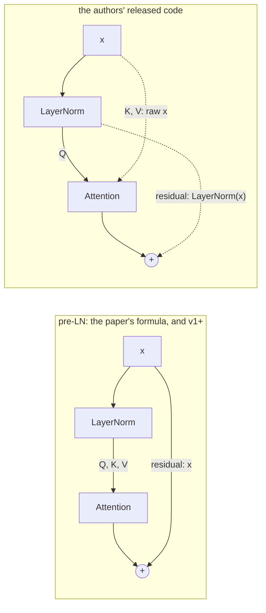
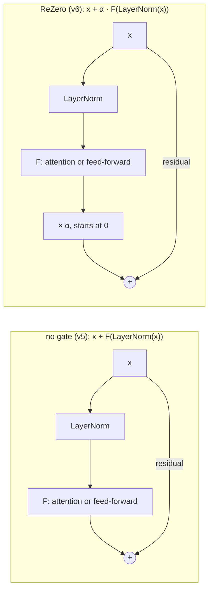

# nanoSASRec Walkthrough

A walkthrough of v1 to v10. Each version builds on the one before and has two parts: **Run**, the command that reproduces it, and **Takeaway**, what changed, the results, and what we learned. v1-v4 train on MovieLens 1M and run on a laptop; v5-v10 train on MovieLens 20M on one GPU. Set `--device` to `cpu`, `mps` or `cuda` for your hardware.

## Differences

Here are known differences from the original SASRec implementation.

- **Pre-LN block wiring**, `x + sublayer(LayerNorm(x))`. This is the formula in the SASRec paper (Section III-C), but not what the authors' released code does. Their code adds the residual back from `LayerNorm(x)` instead of `x`, and normalizes only the attention queries, not the keys and values. The two wirings agree at 2 blocks and part ways with depth: see v4 and v5. Pre-LN is more stable for deeper models (Xiong et al. ICML 2020) and is what HSTU and PinnerFormer use.
- **Weight initialization** uses truncated normal with `std=1/sqrt(d)` (matching Zhai et al. (2024)) instead of the original's Xavier uniform. Keeps initial dot products near zero for stable softmax in early training.
- **Reversed positional embeddings** (Huang 2025, arxiv: 2504.09596). The original uses forward indexing; v4+ counts backward from the prediction position so the model learns "how far back" rather than "what absolute slot."

These are intentional refinements, not bugs. v1-v3 keep PyTorch's default initialization and forward positions; v4+ apply these improvements.

## Reading the Metrics

**Avg loss (Sampled Softmax, or SSM, v2/v4+):** Each training step, the model sees 1 correct item and N random wrong items (256 for ML-1M, 512 for ML-20M) and has to pick the right one. The loss measures how badly it fails at this. If the model has no idea and guesses uniformly across 257 candidates, the probability of guessing right is 1/257 and the loss is -log(1/257) ≈ 5.55 (≈ 6.24 with ML-20M's 513 candidates). As the model learns, it assigns higher probability to the correct item and the loss drops. The `~X% correct` in the training output is exp(-loss): roughly the probability the model gives the correct item among the 257 (or 513) candidates.

v2 and v4-v7 write sampled softmax in its explicit `exp/sum/log` form because it mirrors the equation directly. That version can overflow for very large logits, so v8-v10 switch to the stable `logsumexp` form of the same objective. The training objective does not change, only the numerical implementation does.

| Loss | ~P(correct) | What's happening |
|------|-------------|------------------|
| 5.5 | 0.4% | Guessing randomly |
| 3.0 | 5% | Starting to pick up signal |
| 2.0 | 14% | Learning real patterns |
| 1.0 | 37% | Strong preferences |

**Avg loss (BCE, v1/v3):** Instead of picking from a set, the model answers a yes/no question for each item independently: "is this the next item?" A coin flip gives 50/50 on each question, a loss of -log(0.5) ≈ 0.69. v1 adds the positive's and the negative's loss, so its chance level is 2 × 0.69 ≈ 1.39. Anything below that means the model is doing better than chance. Not directly comparable to SSM loss values since they measure different things. v3 averages the loss over the positive and its 256 negatives, so its chance level is about 0.69 and its values end much smaller (around 0.006).

**How each user's history is split.** Leave-one-out, by time. For a user who watched A, B, C, D, E and F in that order:

```
History, oldest to newest:   A   B   C   D   E   F
                             └─ training ┘   │   └─ test target
                                             └─ validation target

Training     reads A B C       predicts B C D (each position predicts the next item)
Validation   reads A B C D     ranks E against the catalog
Test         reads A B C D E   ranks F against the catalog
```

E is never a training target, but it is part of the history the model reads at test time. Items the user has already seen are left out of the ranking.

**Validation metrics (during training):** HR@10 and NDCG@10 on the second-to-last item of each user. v1-v3 rank it against 100 sampled negatives (1 ground truth + 100 random items). That's fast, but the absolute numbers are inflated. An HR@10 of 0.95 sounds amazing until you realize ranking 1 item out of 101 is much easier than ranking 1 out of 26,744. Sampled metrics can also change which of two models looks better (Krichene & Rendle, KDD 2020). So v4+ validate on the full catalog, the same way as test. Validation and test then use the same yardstick. On ML-20M, validation HR@10 still runs 3 to 3.5 points above test, probably because the last item is harder to predict (it is one step further from the training data). The gap is steady across versions, so validation is a trustworthy signal for picking models and checkpoints.

**Test metrics (final benchmark):** HR@10 and NDCG@10 on the last item of each user, given everything before it, measured against the full item catalog. The model ranks the ground truth against every item in the dataset, except items already in the user's history: 3,416 items for ML-1M and 26,744 for ML-20M. This is the number you compare against published papers. ML-20M uses the same unfiltered catalog as Zhai et al. (2024) and eSASRec (Tikhonovich et al., 2025). v1-v3 report sampled eval only (they're teaching loss functions, not chasing benchmarks). v4+ reports full-catalog test metrics.

**HR@10 (Hit Rate):** Did the ground truth item land in the top 10? Yes = 1, no = 0, averaged across all users.

**NDCG@10 (Normalized Discounted Cumulative Gain):** Not just "did it make the top 10?" but "how high?" The score uses a log discount: 1/log2(rank+1). Rank 1 gets full credit (1.0), rank 2 gets 0.63, rank 5 gets 0.39, rank 10 gets 0.29. The log means there's a big difference between rank 1 and rank 3, but a small difference between rank 8 and rank 10. This matches real user behavior: people click the first few results, rarely scroll to position 10. When you see an average NDCG@10 of 0.20 across 138K users, with HR@10 around 0.34, it means the ground truth item lands around rank 2-3 on average when it does appear in the top 10. NDCG rewards getting the right item to the very top, which is where most clicks happen.

## v1: Vanilla SASRec + BCE Loss

### Run

`uv run python train_v1.py --device mps --epochs 200 --eval-every 20`

### Output

```bash
Number Users: 6,040
Number Items: 3,416
Dataset Lengths: 6040 6040 6040
Model parameters: 211,500
Estimate batches per epoch: 47
[03:39:25] [Epoch 1/200] Avg loss: 5.2743 | Avg P(pos): 0.5329
[03:39:27] [Epoch 2/200] Avg loss: 3.8044 | Avg P(pos): 0.5687
[03:39:28] [Epoch 3/200] Avg loss: 2.7431 | Avg P(pos): 0.5634
[03:39:30] [Epoch 4/200] Avg loss: 2.1077 | Avg P(pos): 0.5583
[03:39:32] [Epoch 5/200] Avg loss: 1.7435 | Avg P(pos): 0.5584
...
[03:40:07] [Epoch 20/200] Avg loss: 1.0641 | Avg P(pos): 0.6203 | HR@10: 0.4396 NDCG@10: 0.2417
[03:40:52] [Epoch 40/200] Avg loss: 0.9954 | Avg P(pos): 0.6032 | HR@10: 0.4454 NDCG@10: 0.2419
[03:41:38] [Epoch 60/200] Avg loss: 0.8853 | Avg P(pos): 0.6050 | HR@10: 0.5399 NDCG@10: 0.3020
[03:42:24] [Epoch 80/200] Avg loss: 0.8148 | Avg P(pos): 0.6111 | HR@10: 0.6013 NDCG@10: 0.3481
[03:43:10] [Epoch 100/200] Avg loss: 0.7498 | Avg P(pos): 0.6140 | HR@10: 0.6627 NDCG@10: 0.3932
[03:43:57] [Epoch 120/200] Avg loss: 0.7109 | Avg P(pos): 0.6134 | HR@10: 0.6919 NDCG@10: 0.4178
[03:44:42] [Epoch 140/200] Avg loss: 0.6713 | Avg P(pos): 0.6269 | HR@10: 0.7139 NDCG@10: 0.4437
[03:45:28] [Epoch 160/200] Avg loss: 0.6383 | Avg P(pos): 0.6281 | HR@10: 0.7397 NDCG@10: 0.4668
[03:46:13] [Epoch 180/200] Avg loss: 0.6164 | Avg P(pos): 0.6375 | HR@10: 0.7568 NDCG@10: 0.4877
[03:46:58] [Epoch 200/200] Avg loss: 0.6040 | Avg P(pos): 0.6405 | HR@10: 0.7661 NDCG@10: 0.4979
[03:47:07] [Epochs 200] Test metrics: HR@10: 0.7356 NDCG@10: 0.4737

  Prediction demo (user 1):
    Recent history:  Toy Story (1995), Bug's Life, A (1998), Antz (1998), Hunchback of Notre Dame, The (1996), Hercules (1997)
    Ground truth:    Pocahontas (1995)
    Model top-10:
       1. Lady and the Tramp (1955)
       2. Lion King, The (1994)
       3. Little Mermaid, The (1989)
       4. Babe (1995)
       5. Shakespeare in Love (1998)
       6. Jungle Book, The (1967)
       7. Fantasia (1940)
       8. Robin Hood (1973)
       9. Groundhog Day (1993)
      10. West Side Story (1961)
```

### Takeaway

**What we built.** A causal Transformer decoder (SASRec) trained with binary cross-entropy loss and 1 negative per positive, evaluated with leave-one-out ranking against 100 random negatives.

**What we learned about the architecture.** Self-attention lets each position in a user's history decide which past items are most relevant for predicting what comes next. The shifted-sequence trick gives us one training signal per position, not just one per user. Residual connections and layer normalization keep gradients flowing through stacked blocks.

**What the metrics mean.** Validation HR@10 = 0.77 means that for 77% of users, the model ranked the actual next item in the top 10 of 101 candidates. NDCG@10 = 0.50 means that when it did, the item tended to land around position 2, not position 10.

**What's wrong: overconfidence.** BCE treats each item as its own yes/no question, "is this the next item?", and with one negative it only has to tell the true item apart from one random item. That is an easy question, so the model learns to say yes freely. Avg P(pos) ends at 0.64: on average the model is 64% sure the true item is next, even though it is one of 3,416 candidates, where a guess would be right about 0.03% of the time (1 in 3,416). Nothing in the loss makes candidates compete with each other, so the model can score many items about as high as the true one. That competition is what v2 adds.

## v2: Sampled Softmax Loss

### Run

`uv run python train_v2.py --device mps --epochs 200 --eval-every 20`

### Output

```bash
Number Users: 6,040
Number Items: 3,416
Dataset Lengths: 6040 6040 6040
Model parameters: 211,500
Estimate batches per epoch: 47
[04:10:27] [Epoch 1/200] Avg loss: 18.3133
[04:10:29] [Epoch 2/200] Avg loss: 12.3495
[04:10:30] [Epoch 3/200] Avg loss: 9.2268
[04:10:32] [Epoch 4/200] Avg loss: 7.5412
[04:10:33] [Epoch 5/200] Avg loss: 6.5564
...
[04:11:05] [Epoch 20/200] Avg loss: 4.7616 | HR@10: 0.4366 NDCG@10: 0.2424
[04:11:44] [Epoch 40/200] Avg loss: 4.5558 | HR@10: 0.4656 NDCG@10: 0.2591
[04:12:23] [Epoch 60/200] Avg loss: 4.0385 | HR@10: 0.6321 NDCG@10: 0.3816
[04:13:02] [Epoch 80/200] Avg loss: 3.7089 | HR@10: 0.6990 NDCG@10: 0.4449
[04:13:41] [Epoch 100/200] Avg loss: 3.4710 | HR@10: 0.7361 NDCG@10: 0.4869
[04:14:20] [Epoch 120/200] Avg loss: 3.3255 | HR@10: 0.7565 NDCG@10: 0.5151
[04:14:59] [Epoch 140/200] Avg loss: 3.2366 | HR@10: 0.7684 NDCG@10: 0.5361
[04:15:37] [Epoch 160/200] Avg loss: 3.1603 | HR@10: 0.7775 NDCG@10: 0.5487
[04:16:17] [Epoch 180/200] Avg loss: 3.0888 | HR@10: 0.7866 NDCG@10: 0.5566
[04:16:57] [Epoch 200/200] Avg loss: 3.0405 | HR@10: 0.7922 NDCG@10: 0.5699
[04:17:06] [Epochs 200] Test metrics: HR@10: 0.7672 NDCG@10: 0.5471

  Prediction demo (user 1):
    Recent history:  Toy Story (1995), Bug's Life, A (1998), Antz (1998), Hunchback of Notre Dame, The (1996), Hercules (1997)
    Ground truth:    Pocahontas (1995)
    Model top-10:
       1. Lion King, The (1994)
       2. Prince of Egypt, The (1998)
       3. Rescuers Down Under, The (1990)
       4. Sleeping Beauty (1959)
       5. Jungle Book, The (1967)
       6. Little Mermaid, The (1989)
       7. Pinocchio (1940)
       8. 101 Dalmatians (1961)
       9. Fantasia (1940)
      10. Alice in Wonderland (1951)
```

### Takeaway

**What we changed.** Only the loss function. The model is identical to v1: same SelfAttention, same AttentionBlock, same SASRec. The diff is in three places: `sample_batch` returns negatives shared by all of a user's positions, shape (batch, num_negs), instead of one per position, shape (batch, seq_len); scoring uses a matmul to score every position against every negative; and BCE is replaced with sampled softmax.

**What sampled softmax does differently.** Instead of a separate yes/no question for each candidate (BCE), sampled softmax asks "which of these 257 items is the correct next one?" The positive competes directly against 256 negatives in one softmax. The probabilities must sum to 1, so the model can't say yes to everything: pushing one item up pushes the others down.

**Why the loss doesn't go to zero.** v2's loss dropped from 18.3 to 3.04 and was still falling slowly. That is expected. A model that spreads probability evenly over the 257 candidates has loss -log(1/257) ≈ 5.55, so 3.04 is well below chance. It can't reach zero, because picking the one true item out of 257 is genuinely uncertain. v1's BCE has no such floor and kept heading toward zero.

**Why NDCG improved more than HR.** HR@10 asks a yes/no question: did the ground truth land in the top 10? v1 already got this right ~77% of the time. The bigger problem was *where* in the top 10 it landed. v1 is never trained to separate candidates from each other, so the order within its top 10 is loose. v2's candidates compete for probability, which pushes the ground truth toward rank 1-3 when it does appear, and that is exactly what NDCG measures. The +0.072 NDCG gain versus +0.026 HR gain is consistent with better-separated scores.

**Why shared negatives work.** Each user's 256 negatives are reused across all 199 positions in their sequence. An unseen item is unseen at every position, so there's no reason to sample different negatives per position. v2 trains in about the same time as v1 (~7 min) while scoring 256× more candidates.

**What's still wrong.** Sampled softmax with 256 negatives is better than BCE with 1, but it only approximates a softmax over the full catalog: each step sees 256/3,416 ≈ 7.5% of the items. Petrov & Macdonald (2023) showed that even sampled softmax is somewhat overconfident: its predicted probabilities run higher than the true ones. v3's gBCE takes a different route: it goes back to BCE and corrects the overconfidence directly, by shrinking the positive term according to how few negatives were sampled.

## v3: Generalized BCE Loss

### Run

`uv run python train_v3.py --device mps --epochs 400 --eval-every 20`

### Output

```bash
Number Users: 6,040
Number Items: 3,416
Dataset Lengths: 6040 6040 6040
Model parameters: 211,500
Estimate batches per epoch: 47
[05:12:34] [Epoch 1/400] Avg loss: 2.4040 | Avg P(pos): 0.4965
[05:12:36] [Epoch 2/400] Avg loss: 1.3705 | Avg P(pos): 0.4623
[05:12:39] [Epoch 3/400] Avg loss: 0.7902 | Avg P(pos): 0.4124
[05:12:41] [Epoch 4/400] Avg loss: 0.4670 | Avg P(pos): 0.3651
[05:12:44] [Epoch 5/400] Avg loss: 0.2810 | Avg P(pos): 0.3302
...
[05:13:36] [Epoch 20/400] Avg loss: 0.0090 | Avg P(pos): 0.3313 | HR@10: 0.4320 NDCG@10: 0.2343
[05:14:45] [Epoch 40/400] Avg loss: 0.0082 | Avg P(pos): 0.4462 | HR@10: 0.4379 NDCG@10: 0.2388
[05:15:53] [Epoch 60/400] Avg loss: 0.0082 | Avg P(pos): 0.4426 | HR@10: 0.4399 NDCG@10: 0.2419
[05:16:56] [Epoch 80/400] Avg loss: 0.0081 | Avg P(pos): 0.4404 | HR@10: 0.4444 NDCG@10: 0.2474
[05:18:04] [Epoch 100/400] Avg loss: 0.0079 | Avg P(pos): 0.3918 | HR@10: 0.4914 NDCG@10: 0.2824
[05:19:07] [Epoch 120/400] Avg loss: 0.0077 | Avg P(pos): 0.3235 | HR@10: 0.5561 NDCG@10: 0.3258
[05:20:15] [Epoch 140/400] Avg loss: 0.0075 | Avg P(pos): 0.3237 | HR@10: 0.6071 NDCG@10: 0.3629
[05:21:25] [Epoch 160/400] Avg loss: 0.0073 | Avg P(pos): 0.3891 | HR@10: 0.6354 NDCG@10: 0.3887
[05:22:33] [Epoch 180/400] Avg loss: 0.0072 | Avg P(pos): 0.4355 | HR@10: 0.6629 NDCG@10: 0.4217
[05:23:40] [Epoch 200/400] Avg loss: 0.0070 | Avg P(pos): 0.4540 | HR@10: 0.6935 NDCG@10: 0.4471
[05:24:22] [Epoch 220/400] Avg loss: 0.0069 | Avg P(pos): 0.4659 | HR@10: 0.7061 NDCG@10: 0.4644
[05:25:05] [Epoch 240/400] Avg loss: 0.0068 | Avg P(pos): 0.4695 | HR@10: 0.7243 NDCG@10: 0.4842
[05:25:48] [Epoch 260/400] Avg loss: 0.0067 | Avg P(pos): 0.4770 | HR@10: 0.7407 NDCG@10: 0.5022
[05:26:30] [Epoch 280/400] Avg loss: 0.0066 | Avg P(pos): 0.4857 | HR@10: 0.7488 NDCG@10: 0.5121
[05:27:13] [Epoch 300/400] Avg loss: 0.0065 | Avg P(pos): 0.4665 | HR@10: 0.7573 NDCG@10: 0.5230
[05:27:56] [Epoch 320/400] Avg loss: 0.0065 | Avg P(pos): 0.4749 | HR@10: 0.7618 NDCG@10: 0.5290
[05:28:38] [Epoch 340/400] Avg loss: 0.0064 | Avg P(pos): 0.4861 | HR@10: 0.7685 NDCG@10: 0.5332
[05:29:21] [Epoch 360/400] Avg loss: 0.0064 | Avg P(pos): 0.4771 | HR@10: 0.7752 NDCG@10: 0.5406
[05:30:03] [Epoch 380/400] Avg loss: 0.0063 | Avg P(pos): 0.4735 | HR@10: 0.7732 NDCG@10: 0.5448
[05:30:46] [Epoch 400/400] Avg loss: 0.0063 | Avg P(pos): 0.4734 | HR@10: 0.7790 NDCG@10: 0.5498
[05:30:54] [Epochs 400] Test metrics: HR@10: 0.7596 NDCG@10: 0.5318

  Prediction demo (user 1):
    Recent history:  Toy Story (1995), Bug's Life, A (1998), Antz (1998), Hunchback of Notre Dame, The (1996), Hercules (1997)
    Ground truth:    Pocahontas (1995)
    Model top-10:
       1. Lion King, The (1994)
       2. Little Mermaid, The (1989)
       3. Lady and the Tramp (1955)
       4. Peter Pan (1953)
       5. Jungle Book, The (1967)
       6. Anastasia (1997)
       7. Sleeping Beauty (1959)
       8. Fantasia (1940)
       9. 101 Dalmatians (1961)
      10. Pocahontas (1995) <- hit
```

### Takeaway

**What we changed.** Only the loss function, again. The model architecture is identical to v1 and v2, and v3 samples 256 negatives per user the same way v2 does. The diff from v2 is the loss: sampled softmax is replaced with generalized binary cross-entropy (gBCE). gBCE goes back to BCE's independent yes/no question for each item, then corrects BCE's overconfidence with one calibration parameter, `t`.

**What gBCE does differently.** With 256 sampled negatives, the model sees only α = 256/3,415 ≈ 7.5% of the items it should be ranked against. BCE trained this way learns probabilities that are far too high: it has no idea how many other items it never saw. gBCE fixes this by raising the positive's predicted probability to a power β, which is the same as multiplying the positive term by β: `-log(P^β) = β · -log(P)`. β comes from `t` and the sampling rate: `β = α · (t · (1 - 1/α) + 1/α)`. With `t = 0`, β = 1 and gBCE is plain BCE. With `t = 1`, β = α and the correction is complete. The paper's default, `t = 0.75`, gives β ≈ 0.31 here. As in the paper's reference code, the loss is the average of the positive term and the 256 negative terms.

**gBCE needs more epochs.** v1, v2 and v4 train for 200 epochs. v3 trains for 400, because at 200 it is still far from done:

| Loss (ML-1M, 256 negatives) | Epochs | Val HR@10 | Val NDCG@10 | Test HR@10 | Test NDCG@10 |
|-----------------------------|--------|-----------|-------------|------------|--------------|
| v2: sampled softmax | 200 | 0.7922 | 0.5699 | 0.7672 | 0.5471 |
| plain BCE (`t = 0`, β = 1) | 200 | 0.7270 | 0.4816 | 0.6959 | 0.4586 |
| gBCE (`t = 0.75`, β ≈ 0.31) | 200 | 0.6944 | 0.4485 | 0.6704 | 0.4285 |
| **v3: gBCE (`t = 0.75`)** | **400** | **0.7790** | **0.5498** | **0.7596** | **0.5318** |

The 200-epoch rows are separate runs, so they differ slightly from epoch 200 of the 400-epoch output above.

The positive is one term out of 257, so the negatives dominate the early gradient. With either BCE variant, validation HR@10 sits near 0.44 for about 80 epochs, about what ranking by popularity scores (0.43), before the model starts using the sequence. (v4's initialization shortens plateaus like this one.) Shrinking the positive term further with β < 1 slows learning again, so at 200 epochs gBCE is behind plain BCE. Given 400 epochs, gBCE reaches sampled softmax on HR@10 (0.7596 against 0.7672) but stays behind on NDCG@10 (0.5318 against 0.5471). The prediction demo shows the difference: at 200 epochs the top 10 is popular 1990s films; at 400 it is Disney animation, with the ground truth at rank 10.

**`t` and the number of negatives work together.** α is the fraction of negatives sampled, so the size of the correction depends on both knobs. With all 3,415 negatives, α = 1 and β = 1 for any `t`: there is nothing to correct. With 256 negatives and `t = 0.75`, β ≈ 0.31. With a single negative, β ≈ 0.25. `num_negatives` sets how big the gap is; `t` sets how much of it to close.

**What calibration buys, and what it doesn't.** gBCE's benefit is in the probability values themselves, which matter when you use a score as a probability, for example multiplying P(purchase) by price to estimate revenue. HR@10 and NDCG@10 only look at the order of the scores, so they can't show it. The `Avg P(pos)` column in the output doesn't show it either: it is the average predicted probability of the true next item during training, and it ends close for gBCE (0.45) and plain BCE (0.48) at 200 epochs. The paper measures calibration against the full catalog, which this repo doesn't compute.

**Why NDCG trails sampled softmax.** gBCE scores each item independently. Sampled softmax makes the candidates compete for probability mass, which pushes the ground truth sharply above its neighbours and helps NDCG most. If you only care about ranking, sampled softmax is the better and faster choice. That is why v4+ use it.

**What we learned about the loss.** v1-v3 hold the architecture fixed and change only the loss, and on ML-1M the loss alone moves the metrics this much. v1's overconfidence, v2's softmax fix and v3's calibration are all about how the training signal is shaped, not about how attention works. This matches Klenitskiy & Vasilev's 2023 finding that the loss, not attention, held SASRec back. Later versions show the architecture still has room: ReZero and relative bias each add about 3% on ML-20M.

## v4: Implementation Refinements

### Run

`uv run python train_v4.py --device mps`

### Takeaway

**What changed.** Same sampled softmax loss as v2, plus five implementation refinements, full-catalog evaluation and resumable checkpoints. v4 is the last single-file version: v5 runs this same script, and v6+ import a shared `sasrec/` package.

**Results on ML-1M (200 epochs, dim=50, blocks=2, heads=1, seed=42, `--device mps`; a CUDA run lands within 0.5 points):**

| Metric | v2 (SSM) | v4 (SSM + refinements) |
|--------|----------|------------------------|
| Val HR@10 (sampled, 100 negatives)* | 0.7922 | 0.8490 |
| Val NDCG@10 (sampled, 100 negatives)* | 0.5699 | 0.6392 |
| Val HR@10 (full-catalog) | — | 0.3189 |
| Val NDCG@10 (full-catalog) | — | 0.1760 |
| Test HR@10 (full-catalog) | — | 0.3017 |
| Test NDCG@10 (full-catalog) | — | 0.1718 |

\*v4's sampled validation numbers are from v0.2.1, before v4+ switched to full-catalog validation. They are kept so v2 and v4 can be compared on the same metric.

Look at the gap between the two kinds of validation. Ranked against 101 items, v4's validation HR@10 is 0.85. Ranked against all 3,416 items, it is 0.32, close to the test HR@10 of 0.30. Same model, two very different numbers. Sampled evaluation makes everything look good, which is why v4+ validate on the full catalog: validation should predict test.

For reference, Zhai et al. (2024) report SASRec on ML-1M at HR@10 0.2853 and NDCG@10 0.1603 with full-catalog eval. Our v4 is higher (0.3017), but the numbers aren't directly comparable: our ML-1M drops items with fewer than 5 ratings (3,416 items), and theirs keeps the full catalog (3,706 items).

**What the refinements do and why they matter:**

- **Truncated normal weight init** (`std=1/sqrt(d)`) was the biggest contributor. PyTorch initializes embeddings from N(0,1) by default, meaning each element has variance 1. When you dot product two dim=50 vectors where each element has variance 1, the result has variance equal to the sum: 50. That means initial attention scores land around ±7 (sqrt(50)), which completely saturates softmax before the model has learned anything. Truncated normal with `std=1/sqrt(d)` keeps initial dot products near zero so softmax starts in its useful range. v2 started at loss 18.3; v4 started at 5.4 and reached v2's final HR by epoch 40 (in v0.2.1, which still used sampled validation).
- **Reversed positional embeddings** give the prediction position a consistent embedding (always index 0) instead of varying by sequence length. The model learns "how far back" rather than "what absolute slot." (Huang 2025, arxiv: 2504.09596)
- **Attention weight dropout** was missing in v1-v3. Standard Transformer implementations (e.g. tensor2tensor) apply dropout to the attention weights after softmax, not just to the output. One line, standard practice.
- **Registered causal mask buffer** avoids recreating the attention mask every forward pass.
- **Configurable FFN** activation and hidden dimension for experimentation.

**One more detail, kept from v1: how each block is wired.** Every version uses pre-LN blocks. Each sublayer (attention, then the feed-forward network) reads `LayerNorm(x)`, and its output is added back onto `x` itself. That is the formula in the SASRec paper, but the authors' released code ([kang205/SASRec](https://github.com/kang205/SASRec)) wires it differently in two places, shown dotted below.



The diagram shows the attention half of a block; the feed-forward half repeats the same residual pattern. Two `train_v4.py` flags each flip one of the dotted wires:

- `--attention-block-residual-from`: what each sublayer's output is added back onto, `input` (`x`, the default) or `normed` (`LayerNorm(x)`).
- `--attention-block-kv-from`: what attention's keys and values read, `normed` (`LayerNorm(x)`, like the queries, the default) or `input` (`x`).

Flip both and you have the authors' code. At v4's 2 blocks the choice hardly matters. With more blocks it decides whether depth works at all, as v5 shows.

**Why the code and the paper differ.** The authors' attention and feed-forward functions come from an earlier TensorFlow Transformer ([Kyubyong/transformer](https://github.com/kyubyong/transformer)). That Transformer was post-LN: the residual add and the LayerNorm sit inside each function. The SASRec code comments out the inner LayerNorm and normalizes the queries before the call instead. The residual add stayed inside, so it now adds back the normalized queries, and the keys and values, passed in separately, stay unnormalized. That looks like a side effect of moving the LayerNorm rather than a design choice, but the authors haven't said.

Others have noticed the mismatch. [pmixer/SASRec.pytorch#47](https://github.com/pmixer/SASRec.pytorch/issues/47) (2025) points it out, and that port has used standard LayerNorm since; they compared at 2 and 3 blocks, where the wirings are close. Many ports still copy the original wiring, among them RecTools' default SASRec layer (which eSASRec's SASRec baseline runs on) and the code behind gSASRec. As far as we found, nobody had tied it to SASRec's collapse with depth, which v5 does.

**The lesson.** v1-v3 proved the loss function matters. v4 proves implementation details matter just as much: +7% HR and +12% NDCG on sampled validation from changes that didn't touch the loss or model capacity. D'Ercoli et al. 2025 documented 2-5% swings from these details individually; they compound.

## v5: Scaling to ML-20M

### Run

`bash train_v5.sh cuda`

This runs everything below in one pass, about 25 A10-hours in all. First, three 3-epoch runs at 8 blocks test each wire on its own (about 15 minutes each). Then, at 2, 4, 8 and 16 blocks, it trains the pre-LN block and the authors' block, shallow depths first.

### Takeaway

> **Note on v5-v11 results:** they use the full 26,744-item ML-20M catalog, like Zhai et al. (2024) and eSASRec (Tikhonovich et al., 2025). v7 and v9 report the mean ± standard deviation over seeds 42-44; the seed-to-seed spread, about 0.1 points of HR@10, is well below the gaps between versions. v0.2.1, the previous release, used a smaller 18,345-item catalog, so its numbers were 0.4 to 1.0 points higher, but the versions ranked in the same order.

**What changed.** No new code. v5 runs `train_v4.py` at different depths (2, 4, 8, 16 attention blocks) on a much larger dataset, with both block wirings from v4. Two things scale up at once: we jump from ML-1M (6K users, 3.4K items) to ML-20M (138K users, 27K items), and from dim=50 to dim=256 with 8 attention heads. The catalog, embedding size (256), sequence length (200) and batch size (128) match Zhai et al.'s (2024) ML-20M setup.

**Results on ML-20M (50 epochs, dim=256, heads=8, batch=128, seed=42, full-catalog eval, one A10 GPU):**

| Blocks | Params | Test HR@10 | Test NDCG@10 | Time/epoch |
|--------|--------|------------|--------------|------------|
| 2 | 7.7M | 0.2938 | 0.1713 | ~73s |
| 4 | 8.5M | 0.3098 | 0.1830 | ~123s |
| 8 | 10.1M | 0.3196 | 0.1912 | ~222s |
| 16 | 13.2M | 0.3280 | 0.1970 | ~419s |

**Depth pays off.** Going from 2 to 16 blocks improves HR by +11.6% and NDCG by +15.0%, and every step up in depth helps. Validation HR@10 was still rising at epoch 50 for every depth, so these runs are not fully converged.

**But depth has diminishing returns.** Each doubling of depth costs roughly 2× the training time for a similar or smaller gain. 16 blocks take 5.7× the compute of 2 blocks for +12% quality. v6 asks whether we can get more from the depth we already have.

**Depth only pays off with pre-LN wiring.** Two papers report plain SASRec collapsing when it gets deep: Guo et al. (2024) from 4 blocks on ML-20M, and eSASRec (Tikhonovich et al., 2025), whose 8-layer SASRec baseline scores HR@10 0.0465. eSASRec's baseline runs on RecTools' port of the SASRec authors' released code, which is wired differently from ours (see v4). Guo et al. say their SASRec "applies [the residual connection] after layer normalization", which matches the authors' code; their repository has no code, so we can't check the keys and values. Running the same sweep with both wiring flags flipped reproduces the collapse:

| Blocks | Pre-LN (v5) Test HR@10 | Pre-LN NDCG@10 | Authors' code Test HR@10 | Authors' code NDCG@10 |
|--------|------------|--------------|------------|--------------|
| 2 | 0.2938 | 0.1713 | 0.3015 | 0.1761 |
| 4 | 0.3098 | 0.1830 | 0.3093 | 0.1823 |
| 8 | 0.3196 | 0.1912 | **0.0446** | **0.0224** |
| 16 | 0.3280 | 0.1970 | **0.0451** | **0.0221** |

At 2 blocks the authors' wiring is slightly ahead, at 4 they tie, and from 8 blocks it never learns. Its training loss sits at about 3.73 from the first epoch to the last, while pre-LN is at 2.03 after 3 epochs. Validation tells the same story. Its 8-block HR@10 (0.0446) lands next to eSASRec's 0.0465, so the collapse those papers report comes from the block wiring, not from SASRec itself ([#32](https://github.com/eifuentes/nanoSASRec/issues/32)).

**Either change alone is enough to collapse.** Because the collapse shows from the first epoch, 3 epochs at 8 blocks are enough to test each change on its own:

| 8 blocks, after 3 epochs | Training loss | Val HR@10 |
|--------------------------|---------------|-----------|
| Pre-LN | 2.03 | 0.2247 |
| Residual from `LayerNorm(x)` only (`--attention-block-residual-from normed`) | 3.74 | 0.0444 |
| Keys and values from `x` only (`--attention-block-kv-from input`) | 3.75 | 0.0463 |
| Authors' code, both flags (seed 43, run separately) | 3.75 | 0.0439 |

These are one seed each. The gaps, about 0.2 against 0.045, are far beyond the seed-to-seed spread. Guo et al. train with BCE and 1 negative and see the collapse from 4 blocks; with sampled softmax we see a tie at 4. We haven't tested whether the loss explains that difference. Their "Llama-style" fix moves the residual back onto `x` and recovers part of the lost accuracy (HR@10 0.138 at 8 blocks against 0.033), which fits the keys-and-values change collapsing on its own here, but without their code we can't confirm it. v6 shows a fix that works on either wiring.

## v6: Gated Residuals

### Run

`uv run python train_v6.py --device cuda`

### Takeaway

v6 is the first version to import the shared `sasrec/` package. The package keeps only the pre-LN wiring, the one that scales in v5; v4's wiring flags stay in `train_v4.py`.

**The problem with stacking blocks.** Each attention block transforms the input and adds its result back to a residual stream that flows through the whole model. With 2 blocks, this works fine. With 8, you have 8 randomly initialized transformations all adding noise to the stream before any of them have learned anything useful. The original item embeddings get buried. Training eventually sorts this out, but early epochs are wasted fighting through noise.

**ReZero's fix is simple.** Scale each sublayer's output (attention and feed-forward) by its own learnable scalar, initialized to zero. At the start of training, every block is zeroed out, so the residual stream is just clean item embeddings flowing through. As training progresses, each scalar grows from zero, gradually turning on blocks as they learn something worth adding. The model decides for itself how much each block should contribute and when. Total cost: 16 extra parameters for 8 blocks.

**Results on ML-20M (dim=256, heads=8, 50 epochs, seed=42, full-catalog eval):**

| Config | Blocks | Params | Test HR@10 | Test NDCG@10 |
|--------|--------|--------|------------|--------------|
| v5 | 2 | 7.7M | 0.2938 | 0.1713 |
| v5 | 8 | 10.1M | 0.3196 | 0.1912 |
| v5 | 16 | 13.2M | 0.3280 | 0.1970 |
| v6 (ReZero) | 8 | 10.1M | 0.3287 | 0.1973 |

ReZero at 8 blocks matches plain SASRec at 16 blocks (0.3287 vs 0.3280) with 3.2M fewer parameters and just over half the training time per epoch (233s vs 419s). 16 scalar parameters buy as much as doubling the depth.

**Gate or no gate.** The only difference between v5 and v6 is a gate between a sublayer's output and the add:



**Two kinds of gate.** ReZero belongs to a family of ways to gate the residual branch:

- **A fixed scale per layer, the same for every input.** ReZero ([Bachlechner et al. 2020](https://arxiv.org/abs/2003.04887)) uses one scalar per sublayer that starts at 0. SkipInit ([De & Smith 2020](https://arxiv.org/abs/2002.10444)) is the same idea for ResNets. LayerScale ([Touvron et al. 2021](https://arxiv.org/abs/2103.17239)) uses one value per channel that starts small.
- **A gate computed from the input.** Examples are highway networks ([Srivastava et al. 2015](https://arxiv.org/abs/1505.00387)), GTrXL's GRU-style gate ([Parisotto et al. 2020](https://arxiv.org/abs/1910.06764)) and LiGR ([LinkedIn 2025](https://arxiv.org/abs/2502.03417)), which eSASRec uses. LiGR's gate is `x + σ(W·x) ⊙ F(LayerNorm(x))`, a learned value per feature and per position. It starts near 0.5, so it halves each sublayer's output instead of switching it off.

`train_v6.py --residual-gate` picks the gate: `none` (v5's block), `rezero` (the default) or `ligr`, which is not implemented yet ([#42](https://github.com/eifuentes/nanoSASRec/issues/42)).

**What each block does before any training.** Here is how far each of the 8 blocks moves the stream at initialization, as a multiple of the stream's own size (0 means the block passes its input through unchanged):

```python
import torch
from sasrec.model import SASRec
from sasrec.model.sasrec import AttentionBlock

torch.manual_seed(42)
model = SASRec(num_items=26744, max_seq_len=200, dropout_rate=0.2, embedding_dim=256, num_blocks=8,
               num_heads=8, residual_gate="none").eval()
moved = []
for block in model.modules():
    if isinstance(block, AttentionBlock):
        block.register_forward_hook(lambda m, i, o: moved.append(((o - i[0]).norm(dim=-1) / i[0].norm(dim=-1)).mean().item()))
with torch.no_grad():
    model(torch.randint(1, 26745, (16, 199), generator=torch.Generator().manual_seed(0)))
print([round(m, 2) for m in moved])  # [8.69, 1.42, 0.87, 0.6, 0.55, 0.44, 0.42, 0.42]
```

| 8 blocks, at initialization | Block 1 | Block 2 | Block 4 | Block 8 | After training |
|-----------------------------|---------|---------|---------|---------|----------------|
| Pre-LN, no gate (v5) | 8.69 | 1.42 | 0.60 | 0.42 | trains |
| Pre-LN + ReZero (v6) | 0 | 0 | 0 | 0 | trains |
| Authors' code, no gate | 13.25 | 0.79 | 0.87 | 1.02 | collapses |
| Authors' code + ReZero | 10.38* | 0 | 0 | 0 | trains |

The first row is the snippet's output. The second comes from setting `residual_gate="rezero"`. The authors'-code rows were measured the same way on an earlier version of this code that had both the wiring flags and ReZero ([#32](https://github.com/eifuentes/nanoSASRec/issues/32)). The shared package now keeps only the pre-LN wiring, so the snippet can't rebuild them.

\*The authors' block starts by normalizing the small item embeddings, which scales them up without changing their direction.

Plain pre-LN is not a pass-through: its first block outweighs the item embeddings almost 9 to 1. These are the buried embeddings described above. Pre-LN still trains, because its residual stream is a plain sum that nothing re-normalizes, and each later block's share of it shrinks. The authors' block keeps moving the stream by about its full size at every block. With ReZero, every block starts as a pass-through on either wiring, and ReZero rescues the authors' block too. In a one-off run at 8 blocks (#32), its loss after 3 epochs is 1.88 with ReZero, the same as v6, against 3.74 without. These numbers describe the start of training only; we haven't measured why the authors' block then stays stuck.

## v7: Relative Position & Temporal Bias

### Run

`uv run python train_v7.py --device cuda`

### Takeaway

**What changed.** Replaced absolute position embeddings with two relative biases added directly to attention scores. Instead of each position having its own learned vector ("what does slot 5 mean?"), the model learns "how far apart are these two items?"

Here's what the distance matrix looks like for a 5-item sequence (each entry is query position minus key position):

```
query ↓    item_1  item_2  item_3  item_4  item_5
item_1  [    0      -1      -2      -3      -4   ]
item_2  [    1       0      -1      -2      -3   ]
item_3  [    2       1       0      -1      -2   ]
item_4  [    3       2       1       0      -1   ]
item_5  [    4       3       2       1       0   ]
```

Negative values mean "this item is in the future." Causal masking zeros those out since items can't attend forward. What remains are the positive distances: "this item was 1 step back, that one was 3 steps back."

We do the same with timestamps. If item_2 happened Monday and item_5 that Thursday, the gap is 3 days. Raw gaps can be huge, so we compress them into 32 buckets. For positions, buckets 0-15 are exact (0, 1, ... 15 steps back) and buckets 16-31 grow by about 17% each (16, 19, 22, ... up to 198). For time, which is in seconds, buckets 0-15 are 0-15 seconds and the rest are log-spaced toward a 30-day cap. Because bucket indices round down, the last bucket actually starts at about 14 days, so anything older than two weeks shares it. On ML-20M that's about a quarter of the item pairs within a user's last 199 items. Each bucket gets a learnable bias per attention head.

These numbers (32 buckets, half exact, half log-spaced) come from T5 (Raffel et al. 2020), a language model; the T5 paper left tuning them to future work, and no recommendation paper we know of tuned them either. Meta's original HSTU code instead uses 128 log buckets for time with no practical cap, and one learned value per position distance with no buckets. Trying those is open work ([#37](https://github.com/eifuentes/nanoSASRec/issues/37), [#38](https://github.com/eifuentes/nanoSASRec/issues/38)).

**Results on ML-20M (8 blocks, dim=256, heads=8, 50 epochs, full-catalog eval; v6 is seed 42, v7 is mean ± std over seeds 42-44):**

| Config | Test HR@10 | Test NDCG@10 |
|--------|------------|--------------|
| v6 (ReZero, absolute pos) | 0.3287 | 0.1973 |
| v7 (ReZero, relative + temporal) | 0.3380 ± 0.0009 | 0.2025 ± 0.0011 |

**Relative bias is as big a step as ReZero, and makes v7 the best model in the repo.** v7 beats v6 by +2.8% HR and +2.6% NDCG, the same +2.8% HR that ReZero added over plain 8-block SASRec. Unlike absolute position embeddings that encode "what slot is this," relative bias encodes "how far apart are these items" which is what actually matters for sequential patterns. The temporal bias lets "items consumed in the same session" get a different learned weight than "items months apart." Guo et al. (2024) find the temporal bias matters more than the positional one; this repo turns both on together (`--rel-bias`) and doesn't separate them.

Relative bias is also compact: 512 parameters (256 each for position and time) against 50,944 for absolute position embeddings. With 32 buckets shared across all positions, the model has to learn general distance patterns rather than per-slot behavior, which may act as a regularizer.

## v8: HSTU

### Run

`uv run python train_v8.py --device cuda`

### Takeaway

**What is HSTU?** HSTU (Hierarchical Sequential Transduction Unit) is the sequential recommendation block introduced by Zhai et al. (2024) at Meta, who report deploying it in production. v8 implements the first local version inside `train_v8.py`; v9+ uses the shared implementation in `sasrec/model/hstu.py`.

Three things change from SASRec's Transformer block:

**1. SiLU replaces softmax in attention.** Softmax normalizes attention weights to sum to 1, making it a zero-sum game: attending more to one item means attending less to others. SiLU removes this constraint. Each item's weight is independent, so the model can strongly attend to several items at once without diluting the signal.

**2. LayerNorm after attention.** Without softmax keeping values bounded, attention outputs can grow large. LayerNorm stabilizes them.

**3. Gating replaces the feed-forward network.** SASRec uses a 2-layer FFN after attention. HSTU replaces it with a pointwise gate: a separate projection U(X) from the raw input gets multiplied element-wise with the attention output. Each feature dimension is the product of "what attention found" and "what the raw input says." This lets the model selectively pass, amplify, or suppress each dimension, similar in spirit to SwiGLU in LLaMA.

Our HSTU also differs from Meta's in a way that matters for depth: it has no LayerNorm on the block input, so its projections read the raw stream. That is the kind of wire that collapses SASRec in v5, yet our HSTU trains at 8 blocks. Its ReZero residual (v6) is the likely reason, but we haven't tested that ([#30](https://github.com/eifuentes/nanoSASRec/issues/30)).

**Results on ML-20M (8 blocks, dim=256, heads=8, 50 epochs, full-catalog eval; seed 42 except v7, which is mean ± std over seeds 42-44):**

| Config | Test HR@10 | Test NDCG@10 |
|--------|------------|--------------|
| v5 blocks=8 (SASRec) | 0.3196 | 0.1912 |
| v6 (+ ReZero) | 0.3287 | 0.1973 |
| **v7 (+ relative bias)** | **0.3380 ± 0.0009** | **0.2025 ± 0.0011** |
| v8 (HSTU) | 0.3236 | 0.1929 |
| SASRec (Zhai et al., 2024) | 0.2889 | 0.1621 |
| HSTU (Zhai et al., 2024, 4 blocks) | 0.3273 | 0.1895 |
| HSTU-large (Zhai et al., 2024, 16 blocks) | 0.3556 | 0.2098 |
| HSTU, recomputed (Tikhonovich et al., 2025) | 0.3464 | 0.2040 |
| eSASRec, 8 blocks (Tikhonovich et al., 2025) | 0.3457 | 0.2107 |

**The architecture swap is not a clear win at this scale.** v8 keeps v7's relative bias and ReZero and swaps softmax + feed-forward for SiLU + gating. It beats the 8-block v5 SASRec (0.3236 against 0.3196) but lands below v6 (0.3287) and v7 (0.3380).

**HSTU starts fast, then flattens.** The validation curves show a pattern the final numbers hide. At epoch 10, v8 is already ahead of v7 (validation HR@10 0.3291 against 0.3281), and v9 leads every model in the repo (0.3356). By epoch 50 the order has reversed. Over their last 10 epochs, v8 and v10 gained only about 0.2 points of validation HR@10, while v5 (8 and 16 blocks), v6 and v7 gained 0.34 to 0.58 points and were still climbing. v9 varies by seed: 0.16 to 0.64 points.

| Validation HR@10 at epoch (seed 42) | 10 | 20 | 30 | 40 | 50 |
|-------------------------------------|----|----|----|----|----|
| v5 blocks=8 (SASRec) | 0.2974 | 0.3242 | 0.3347 | 0.3447 | 0.3504 |
| v7 (+ relative bias) | 0.3281 | 0.3506 | 0.3606 | 0.3684 | 0.3729 |
| v8 (HSTU) | 0.3291 | 0.3409 | 0.3495 | 0.3561 | 0.3581 |
| v9 (+ φ1) | 0.3356 | 0.3510 | 0.3608 | 0.3674 | 0.3690 |

So 50 epochs undertrains the SASRec line more than the HSTU line. We checked by re-running v5 (8 blocks), v7, v8, v9 and v10 for 100 epochs (seed 42, plus seeds 43 and 44 for v7). The SASRec versions gained about 1 point of test HR@10 and the HSTU versions 0.7 to 0.8, so v7's lead over v8 grew from 1.4 to 1.6 points:

| Test at 100 epochs (seed 42; v7 is mean ± std over seeds 42-44) | HR@10 | NDCG@10 | HR@10 at 50 epochs |
|------------------------------|-------|---------|--------------------|
| v5 blocks=8 (SASRec) | 0.3297 | 0.1976 | 0.3196 |
| v7 (+ relative bias) | 0.3473 ± 0.0013 | 0.2098 ± 0.0005 | 0.3380 ± 0.0009 |
| v8 (HSTU) | 0.3313 | 0.1976 | 0.3236 |
| v9 (+ φ1) | 0.3426 | 0.2061 | 0.3344 |
| v10 (+ temp + L2 + collision) | 0.3336 | 0.1992 | 0.3269 |

v8 still learns faster early on, but v5 catches up: v8's lead over the same-depth SASRec shrinks from 0.4 points to under 0.2. The order of the versions is the same at both budgets, and v9 keeps its 1.1-point lead over v8.

**How this compares with published numbers.** The fair reference is eSASRec's recomputed HSTU, which re-runs Meta's code on the same split we use; Zhai et al.'s own rows come from a split that reorders tied timestamps. At 100 epochs, the budget eSASRec uses, v7 draws level with eSASRec and the recomputed HSTU, while our best HSTU (v9) stays 0.4 points of HR@10 behind the recomputed one. Our HSTU still differs from Meta's in a few places, which [#30](https://github.com/eifuentes/nanoSASRec/issues/30) tests. The README's [Benchmarks](README.md#benchmarks) and [Training longer](README.md#training-longer) sections have the full comparison.

## v9: φ1 SwishLayerNorm Pre-Activation

### Run

`uv run python train_v9.py --device cuda`

### Takeaway

**What changed.** Combined the four separate Q, K, V, U linear projections into a single projection (dim to 4*dim), then applied SwishLayerNorm before splitting them apart. SwishLayerNorm is `x * sigmoid(LayerNorm(x))`: LayerNorm normalizes the combined projection, sigmoid gates each dimension between 0 and 1, and multiplying by the original lets the model decide how much to keep.

This matters because the projections must be combined. LayerNorm computes statistics (mean, variance) across the full 4*dim dimension, so Q's normalization depends on what U, V, and K look like. Separate projections with separate LayerNorms would be a different operation.

The result is that Q, K, V, U become nonlinear functions of the input before they interact. In v8, attention scores were a bilinear form (linear Q dotted with linear K). In v9, both Q and K pass through a nonlinearity first, giving the model a richer set of patterns it can represent.

**Results on ML-20M (8 blocks, dim=256, heads=8, 50 epochs, full-catalog eval; v8 is seed 42, v9 is mean ± std over seeds 42-44):**

| Config | Params | Test HR@10 | Test NDCG@10 |
|--------|--------|------------|--------------|
| v8 (HSTU, separate projections) | 9.5M | 0.3236 | 0.1929 |
| **v9 (HSTU, combined + φ1)** | **9.5M** | **0.3354 ± 0.0009** | **0.2008 ± <0.0001** |
| HSTU (Zhai et al., 2024, 4 blocks) | — | 0.3273 | 0.1895 |
| HSTU, recomputed (Tikhonovich et al., 2025) | — | 0.3464 | 0.2040 |

**φ1 improved over v8 by +3.6% HR and +4.1% NDCG.** That recovers 82% of v8's gap to v7 and brings v9 within 1.1 points of HR@10 of the recomputed HSTU. v9 also learns fastest: at epoch 10 its validation HR@10 is 0.3356, against 0.3281 for v7, though v7 draws level by epoch 30 and passes it by epoch 40. But v7 (0.3380), which keeps SASRec's softmax attention, still leads the repo. At this scale, swapping the attention mechanism hasn't gained anything, while ReZero and relative bias each added about 3%.

## v10: Training Alignment

### Run

`uv run python train_v10.py --device cuda`

### Takeaway

**What changed.** Three training details from the Zhai et al. (2024) HSTU setup, applied on top of v9's architecture:

**L2 normalization.** Normalize both the model's output embeddings and the item embeddings to unit length before scoring. This turns dot products into cosine similarity, bounded between [-1, 1]. Without it, the model can give popular items larger embedding norms so they score high regardless of relevance. With it, all items compete on direction (angular similarity) alone.

**Temperature scaling.** Divide all logits by a temperature parameter (0.05) before the softmax loss. With cosine similarity in [-1, 1], dividing by 0.05 scales logits to [-20, 20]. This forces the softmax to commit hard to its top picks. A higher temperature (softer distribution) lets the model be vague about rankings.

**Collision masking.** If a sampled negative is the same item as the positive, mask it out so the model isn't penalized for scoring the right item highly. In this repo it never fires: `sample_batch` already skips every item in the user's history, so a negative can't equal a target. It is kept because samplers that don't filter (like in-batch negatives) need it.

These are standard techniques in production recommendation systems and appear in the Zhai et al. (2024) HSTU training setup.

**Results on ML-20M (8 blocks, dim=256, heads=8, 50 epochs, full-catalog eval; v10 is seed 42, v9 is mean ± std over seeds 42-44):**

| Config | HR@10 | NDCG@10 |
|--------|-------|---------|
| v9 (raw dot products) | 0.3354 ± 0.0009 | 0.2008 ± <0.0001 |
| v10 temp=0.05 | 0.3269 | 0.1949 |

**These techniques didn't help at our scale.** v10 underperformed v9 by 0.9 points of HR@10, as it did on the v0.2.1 catalog across every temperature tried there. Training longer doesn't change that: at 100 epochs v10 is still 0.9 points behind v9 (0.3336 against 0.3426, seed 42). We don't know why yet. Zhai et al.'s ML-20M configs use the same temperature and L2 norm with random negatives, as we do, so the negative sampler doesn't explain it. Other differences remain: they use 128 negatives (we use 512), and their HSTU divides the SiLU attention by sequence length. We haven't isolated which one matters.

One plausible factor: L2 normalization removes a degree of freedom. Without it, the model can use embedding size as a signal, and popular items tend to develop larger norms. On ML-20M that popularity signal may be useful, and removing it may hurt.

**The lesson for practitioners.** These training details don't help everywhere. They interact with the rest of the pipeline, such as the number of negatives and how attention is scaled, so adopting them one at a time may not reproduce what the paper saw. [#30](https://github.com/eifuentes/nanoSASRec/issues/30) tests the remaining differences one by one.

## Appendix: Dense All Action

### Run

`uv run python train_v11.py --device cuda`

### Takeaway

**What changed.** Instead of each position predicting only the next item, every position predicts the next K items (`--horizon`, default 10). Position 3 predicts items 4 through 13. That gives about K times more training targets per sequence without changing the model.

The implementation is memory-efficient: precompute `logsumexp` of negative scores once per position, then reuse it for every future target. Total extra memory is one (batch, seq_len, seq_len) tensor.

**Results on ML-20M (8 blocks, dim=256, heads=8, 50 epochs, full-catalog eval; v11 is seed 42, v9 is mean ± std over seeds 42-44):**

| Variant | HR@10 | NDCG@10 |
|---------|-------|---------|
| v9 (next-item only) | 0.3354 ± 0.0009 | 0.2008 ± <0.0001 |
| Dense All Action (K=10 horizon) | 0.2507 | 0.1375 |

**Why it doesn't work for next-item evaluation.** For a sequence of length 199 with horizon K=10, each position predicts its next 10 items. The next-item prediction (the diagonal) is 1 out of 10 targets, so only 10% of the gradient signal targets the metric we actually evaluate on. The other 90% optimizes for predicting items 2-10 steps ahead.

**What Dense All Action is actually for.** PinnerFormer introduced this technique for temporal embedding stability at Pinterest. If the model can predict not just the next item but all future items, then user embeddings computed today are still useful for serving recommendations tomorrow. The evaluation in PinnerFormer reflects this: they measure whether embeddings from 24 hours ago still produce good recommendations today. That's a different objective than next-item HR@10.

**The open-source generative-recommenders implementation does not use Dense All Action for the ML-20M benchmark.** The Zhai et al. (2024) ML-20M results (HR@10 0.3273) use standard next-item sampled softmax loss, the same as our v9. Dense All Action is referenced conceptually but is not part of the benchmark code.
